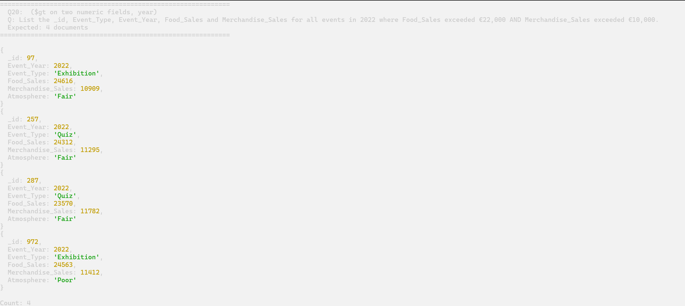
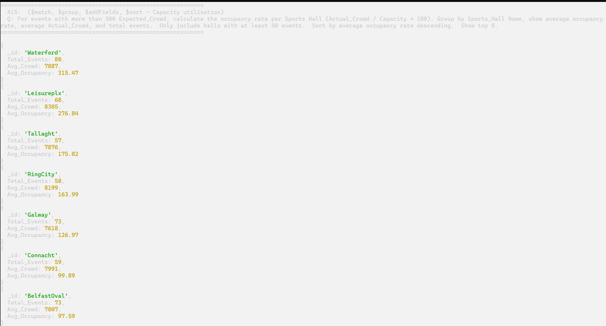
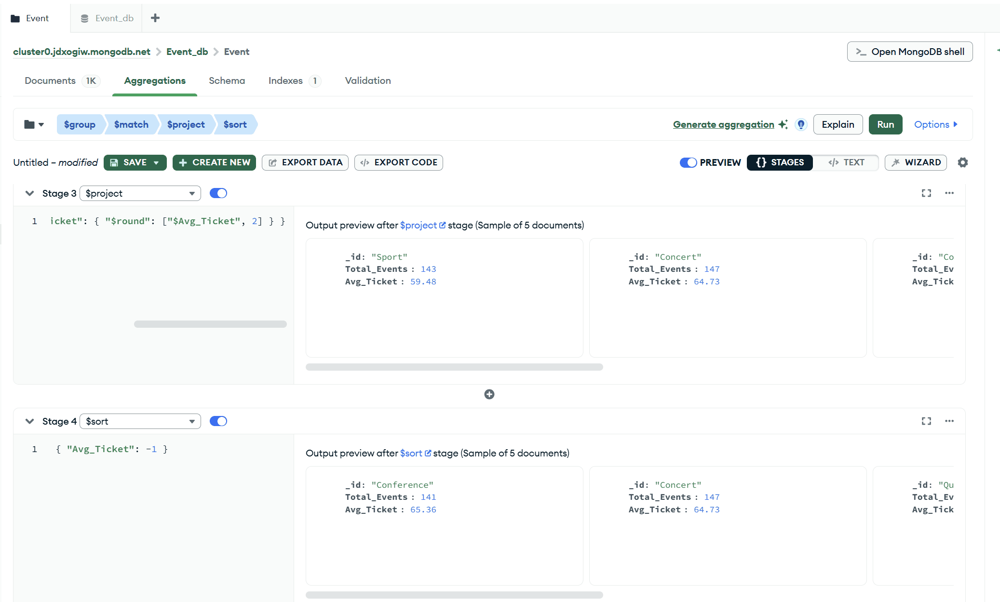

# Sports Hall Events: MongoDB Database Project

A document database of 1,000 events held at Irish sports halls, built and queried in MongoDB. The project covers data modelling with embedded documents and arrays, 35 query-language questions, 15 aggregation pipelines, and running the same work in the Mongo Shell, MongoDB Compass and MongoDB Atlas.

Completed for the Advanced Relational Database module of my MSc in Data Analytics (2026).

## Project at a glance

| | |
|---|---|
| **Database** | `Event_db`, collection `Event` |
| **Documents** | 1,000 events, 2019 to 2024, at 15 sports halls |
| **Simple queries** | 35 (Q1 to Q35), each with a written question and expected result count |
| **Aggregation pipelines** | 15 (A1 to A15) |
| **Tools** | Mongo Shell (mongosh), MongoDB Compass, MongoDB Atlas, Excel (data generation) |
| **Video walkthroughs** | 7 screencasts, listed [below](#video-walkthroughs) |
| **Screenshots** | 65 result screenshots from mongosh, Compass and Atlas, in [`docs/screenshots`](docs/screenshots) |
| **Verified** | All 35 queries return their expected counts (see [Verification](#verification)) |

## Video walkthroughs

| Video | What it covers |
|---|---|
| [Setup and data import](https://youtu.be/7ft50i_3DAA) | Creating the database and importing the 1,000 documents |
| [Pipelines A1 and A3](https://youtu.be/kJ2FtkDr2uE) | Grouping by event type; unwinding the Sponsors array |
| [Pipelines A9 and A14](https://youtu.be/W3Q1eaezDpg) | Ticket price bands with `$bucket`; a dashboard with `$facet` |
| [Pipeline A12](https://youtu.be/rmoX4PZvArI) | Classifying food sales with `$cond` |
| [Pipeline A15](https://youtu.be/Bxuv2mCgDjE) | Hall occupancy rate with `$addFields` and `$divide` |
| [Compass and Atlas: filter queries](https://youtu.be/s52I9tMq8ug) | Running the CQ filter queries in Compass and Atlas |
| [Compass and Atlas: aggregation](https://youtu.be/sf2b1SGZXAU) | Building the CA pipelines in the Compass and Atlas aggregation tabs |

| Setup and import | Aggregation pipelines | Compass and Atlas |
|---|---|---|
| [](https://youtu.be/7ft50i_3DAA) | [](https://youtu.be/kJ2FtkDr2uE) | [](https://youtu.be/s52I9tMq8ug) |

## Screenshots

Every query and pipeline was run against the live Atlas cluster, and the output was captured. The full set of 65 screenshots is in [`docs/screenshots`](docs/screenshots), with an index.

| Folder | Contents |
|---|---|
| [`01_setup`](docs/screenshots/01_setup) | `mongoimport`, `countDocuments()` returning 1,000, and `findOne()` |
| [`02_find_queries`](docs/screenshots/02_find_queries) | Q1 to Q35 in mongosh |
| [`03_aggregations`](docs/screenshots/03_aggregations) | A1 to A15 in mongosh |
| [`04_compass_atlas`](docs/screenshots/04_compass_atlas) | Atlas cluster and Data Explorer, Compass connection, filter queries and aggregation builder |

| Q20 in mongosh | A15 in mongosh | A1 in the Compass aggregation builder |
|---|---|---|
|  |  |  |

## Data model

Each event is one document. Venue and technician details are **embedded documents**, and sponsors, refreshments and the sports a hall supports are **arrays**. This lets most questions be answered from a single document, without joins.

```json
{
  "_id": 1,
  "Event_Year": 2023, "Event_Month": "Jan", "Event_Type": "Concert",
  "Duration": 203, "Expected_Crowd": 4706, "Actual_Crowd": 4265,
  "Ticket_Price": 22,
  "Sponsors": ["Aldi", "Tesco", "Dunnes"],
  "Sponsorship_Value": 15031, "Sponsor_Type": "Tourism",
  "Refreshments": ["Tea", "Coffee", "Water", "SoftDrinks"],
  "Food_Sales": 7723, "Merchandise_Sales": 7559,
  "Atmosphere": "Good", "Security_Cost": 6930,
  "Sports_Hall": {
    "Name": "Connacht", "City": "Roscommon", "County": "Roscommon",
    "Sport": ["MultiPurpose"], "Seating": "Fixed", "Floor_Type": "Vinyl",
    "Energy_Source": "Biomass", "Lighting_Type": "Natural",
    "Year_Built": 2015, "Cost": 610000, "Capacity": 8000, "Acoustics": "Fair"
  },
  "Technician": {
    "Name": "Joe Murphy", "Town": "Mullingar", "County": "Westmeath",
    "Qualification": "Cert", "Total_Hours": 5, "Hourly_Fee": 73
  }
}
```

## Query coverage

**Simple queries (Q1 to Q35)** use:

| Feature | Example question |
|---|---|
| Comparison: `$eq`, `$ne`, `$gt`, `$gte`, `$lte` | Q8: events in 2023 with an Excellent atmosphere and tickets between €80 and €100 |
| Sets: `$in`, `$nin` | Q22: 2024 events with a Fair atmosphere and tickets over €100, excluding Meetings and Sport |
| Logic: `$and`, `$or` | Q35: Excellent events with tickets over €110 in either 2019 or 2024 |
| Arrays: `$all`, `$size`, exact match | Q12: events sponsored by both Tesco and Lidl |
| Pattern matching: `$regex` | Q15: technicians whose names start with "Dan" |
| Dot notation into embedded documents | Q11: Degree-qualified technicians charging over €75 an hour |

**Aggregation pipelines (A1 to A15)** use `$match`, `$group`, `$project`, `$sort`, `$limit`, `$unwind`, `$addFields`, `$bucket`, `$facet` and `$cond`, with `$sum`, `$avg`, `$max`, `$min`, `$add`, `$multiply`, `$divide` and `$round`. Examples:

- **A3:** unwinds the Sponsors array to find the five most frequent sponsors
- **A8:** calculates total revenue per event (tickets, food and merchandise) and lists those over €400,000
- **A9:** buckets events into ticket price bands and compares average crowds
- **A12:** classifies average food sales as High, Medium or Low with `$cond`
- **A14:** builds a three-part summary dashboard in one query with `$facet`

## Key findings

The dataset is synthetic: it was generated from lookup lists for practice, so these findings describe the data rather than real Irish venues.

- **Sponsors:** Aldi appears most often (424 events), followed by SuperValu and Dunnes. Lidl events have the highest average sponsorship value, at about €26,000.
- **Ticket prices:** Conferences and Concerts have the highest average ticket prices, at about €65.
- **Free events:** 140 events were free. Their average crowd was about 7,970, compared with about 7,130 for the most expensive band (€91 to €120).
- **Technicians:** Hourly fees are almost the same across Cert, Diploma and Degree technicians, at €54 to €56.

### Data quality note

Pipeline A15 calculates occupancy (actual crowd ÷ hall capacity). Several halls average well over 100%, with Waterford at about 315%. That happened because the generator picked crowd sizes independently of each hall's capacity. In a real project, I would cap crowd size at the venue's capacity when generating the data, or flag those records during cleaning.

## Repository structure

```
data/
  sports_hall_events.json      1,000 event documents, ready for mongoimport or Compass
  generation/                  Excel workbooks used to build the data and format it as JSON
queries/
  mongo_shell_queries.js       All 35 simple queries and 15 aggregation pipelines with their questions
  compass_atlas_queries.txt    The same work adapted for the Compass and Atlas interfaces
scripts/
  verify_query_counts.py       Checks all 35 query counts without a MongoDB server
docs/progress_logs/            Six progress logs, July to August 2026 (Uploads 1 to 6)
docs/screenshots/              65 screenshots of results in mongosh, Compass and Atlas
```

## How to run

1. **Import the data**, either:
   - in Compass: create database `Event_db` and collection `Event`, then use **Add Data, Import JSON**, or
   - from the command line:
     ```
     mongoimport --db Event_db --collection Event --jsonArray --file data/sports_hall_events.json
     ```
2. **Run the queries** in mongosh:
   ```
   use Event_db
   load("queries/mongo_shell_queries.js")
   ```
3. **Atlas:** connect with your own connection string. The reference file uses a placeholder, and no real credentials are stored in this repo.

## Verification

`scripts/verify_query_counts.py` reads each query's filter from the `.js` file and evaluates it against the JSON data with plain Python. It then compares the result with the expected count written beside each question. All 35 match, and the document IDs in the screenshots match the IDs the script returns.

```
python scripts/verify_query_counts.py
```

## Licence

Code and data are released under the [MIT Licence](LICENSE).
